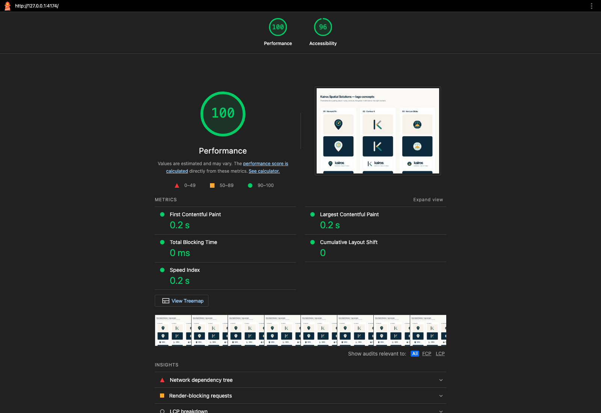
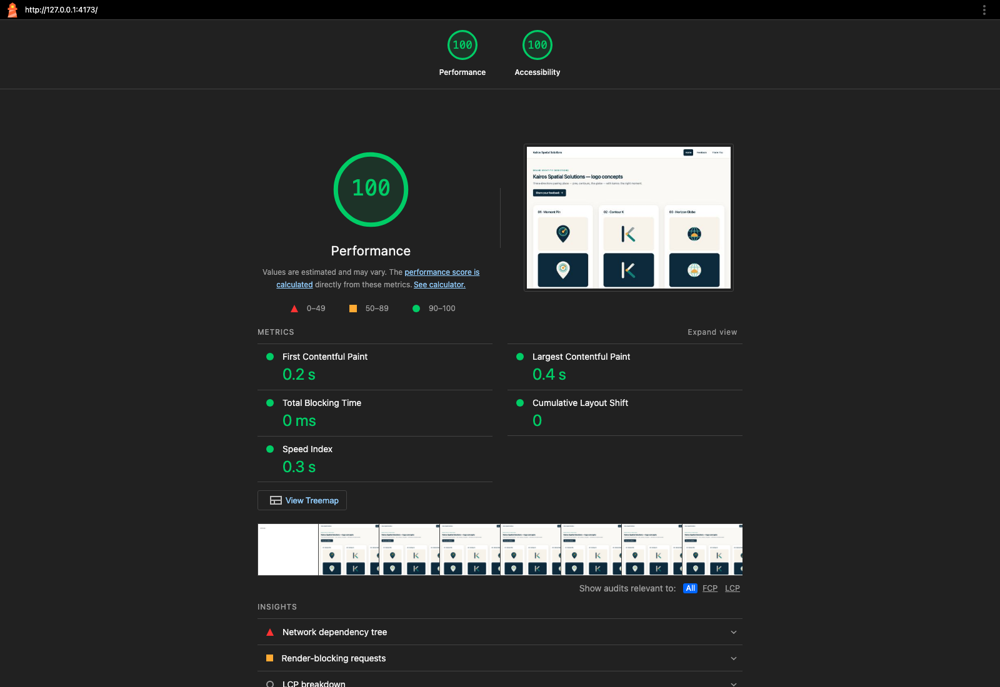
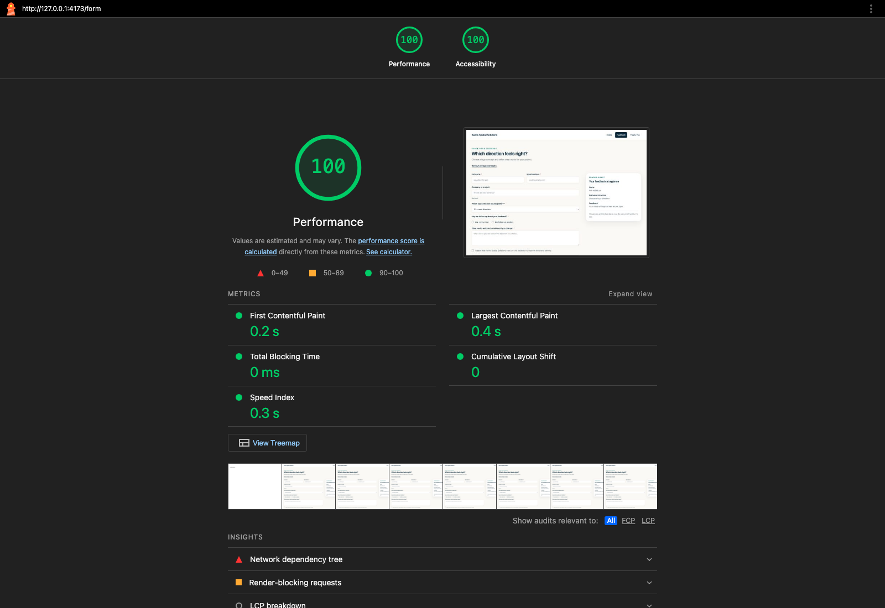

# Kairos Spatial Solutions — Multi-Page Feedback App

A responsive React app for exploring three logo concepts and sending feedback. The Week 5 form is now part of a routed app with shared reducer state, keyboard support, and production Lighthouse evidence.

## Routes

| Route | Page |
| --- | --- |
| `/` | Home and logo concepts |
| `/form` | Feedback form and live draft preview |
| `/thank-you` | Confirmation and the submitted draft summary |
| `/items/:itemId` | Dynamic concept detail page; reads `itemId` with `useParams` |
| Any other URL | 404 page |

The shared header uses `NavLink`; the active page has a dark background and `aria-current="page"`.

## Shared state and form behavior

`App.jsx` owns the form data with `useReducer`. Named actions update each field (`UPDATE_NAME`, `UPDATE_EMAIL`, `UPDATE_COMPANY`, `UPDATE_INTEREST`, `UPDATE_CONTACT_METHOD`, `UPDATE_MESSAGE`, and `UPDATE_CONSENT`) or reset the form. The form and `FeedbackPreview` are sibling components that read and update the same draft. The draft also remains available on the Thank You route.

## Accessibility and performance work

- A skip link is the first focusable element in the shared layout on every route and moves focus to that page’s main content.
- All links, buttons, and form controls have a visible `:focus-visible` outline. Route changes move focus to the new page heading region, and reduced-motion preferences are respected.
- Form labels, fieldsets, validation feedback, and live draft text remain available to assistive technology.
- Page components are loaded with `React.lazy`, splitting Home, Feedback, Thank You, concept detail, and 404 code into route chunks.

### Lighthouse scores

Lighthouse 13.6.0, Chrome desktop preset, production builds. The baseline is the original committed Week 5 app; the final build was audited on both Home and Feedback. Scores can vary slightly by machine. Performance stayed at 100, the maximum score; accessibility improved from 96 to 100.

| Build | Page | Performance | Accessibility |
| --- | --- | ---: | ---: |
| Before | `/` | 100 | 96 |
| After | `/` | 100 | 100 |
| After | `/form` | 100 | 100 |

### Audit findings and fixes

| Page / review | Finding | Rule or criterion | Fix applied | Before → after score |
| --- | --- | --- | --- | --- |
| Home · Lighthouse | Three `SPATIAL SOLUTIONS` labels used teal on navy at 3.11:1 contrast. | Lighthouse `color-contrast`; WCAG 1.4.3 Contrast (Minimum), 4.5:1 for this small text. | Dark lockups use mint text, which clears the contrast requirement; no contrast failures remain on Home or Feedback. | Home accessibility 96 → 100; Feedback after: 100 |
| All routes · keyboard review | No skip link was present, so keyboard users had to tab through shared navigation to reach page content. | WCAG 2.4.1 Bypass Blocks. | Added a skip link as the first focusable element and a focusable `main` target on every route. | Home accessibility 96 → 100; Feedback after: 100 |

### Lighthouse report screenshots

These screenshots show the Lighthouse report scores. The full HTML and JSON reports are in [`audit/reports`](./audit/reports/).

**Before — Home (100 Performance, 96 Accessibility)**



**After — Home (100 Performance, 100 Accessibility)**



**After — Feedback (100 Performance, 100 Accessibility)**



### Performance optimization evidence

The production build splits page code into separate chunks, so routes load their page components when visited. For example, the Home page chunk is 4.14 kB (1.41 kB gzip) and the Feedback page chunk is 9.40 kB (3.06 kB gzip). Lighthouse performance remained 100 before and after this routing change.

## Run locally

Use Node.js 20.19+ or 22.12+.

```bash
npm install
npm run dev
```

To produce the optimized route chunks:

```bash
npm run build
npm run preview
```

The feedback form is a frontend demonstration. It validates and displays a confirmation, but does not send or store details.

## Project structure

```text
src/
├── App.jsx
├── data/concepts.js
├── state/formState.js
├── components/
│   ├── ConceptVisuals.jsx
│   ├── FormField.jsx
│   ├── InquiryForm.jsx
│   └── SiteLayout.jsx
└── pages/
    ├── ConceptDetailPage.jsx
    ├── FeedbackPage.jsx
    ├── HomePage.jsx
    ├── NotFoundPage.jsx
    └── ThankYouPage.jsx

audit/
├── reports/       # Lighthouse HTML and JSON output
└── screenshots/   # Before and after Lighthouse report screenshots
```
